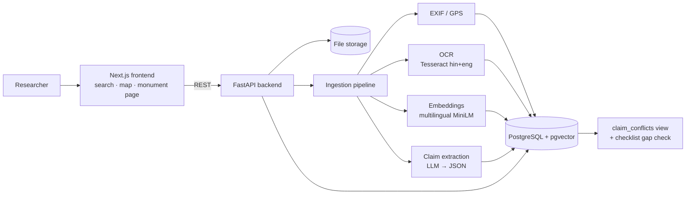

# KathaGraph

**An evidence-aware heritage archive.** KathaGraph turns messy fieldwork files (photos, scanned Devanagari/English documents, field notes) into a searchable, mapped knowledge base. Every fact links back to its source. Where sources disagree, the conflict is shown side by side. For each monument, it lists what documentation is still missing.

Built for HackCult '26, Track 2: Cultural & Digital Heritage.

## Architecture



**Key design rule:** claims are stored separately from sources, with method, confidence and review status. The AI suggests; it never decides what's true.

See `CONTRACT.md` for API shapes and `backend/schema.sql` for the database.

## Repo layout
```
backend/    FastAPI app, schema.sql, Dockerfile
frontend/   Next.js + Tailwind app
CONTRACT.md API contract between frontend and backend
```

## Run locally

**Backend** (Python 3.10+)
```bash
cd backend
python -m venv .venv && source .venv/bin/activate   # Windows: .venv\Scripts\activate
pip install -r requirements.txt
cp .env.example .env        # then paste your Supabase DATABASE_URL
uvicorn app.main:app --reload
# open http://localhost:8000/health
```

**Frontend** (Node 20+)
```bash
cd frontend
npm install
cp .env.example .env.local
npm run dev
# open http://localhost:3000
```

## Deploy
- **Database:** Supabase. Run `backend/schema.sql` in the SQL Editor.
- **Backend:** Render → New Web Service → this repo, root directory `backend`, runtime Docker. Set env vars `DATABASE_URL` and `CORS_ORIGINS` (your Vercel URL).
- **Frontend:** Vercel → import repo, root directory `frontend`. Set env var `NEXT_PUBLIC_API_URL` (your Render URL).

## Team
- _Name 1_: backend & pipeline
- _Name 2_: frontend, data & demo
