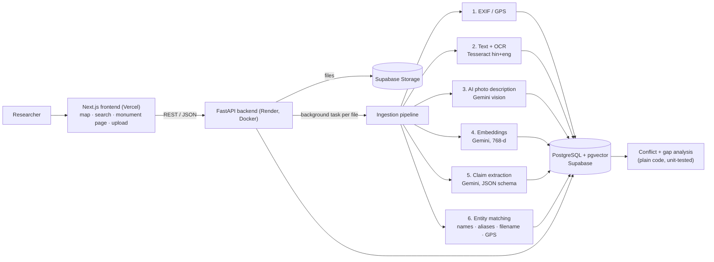
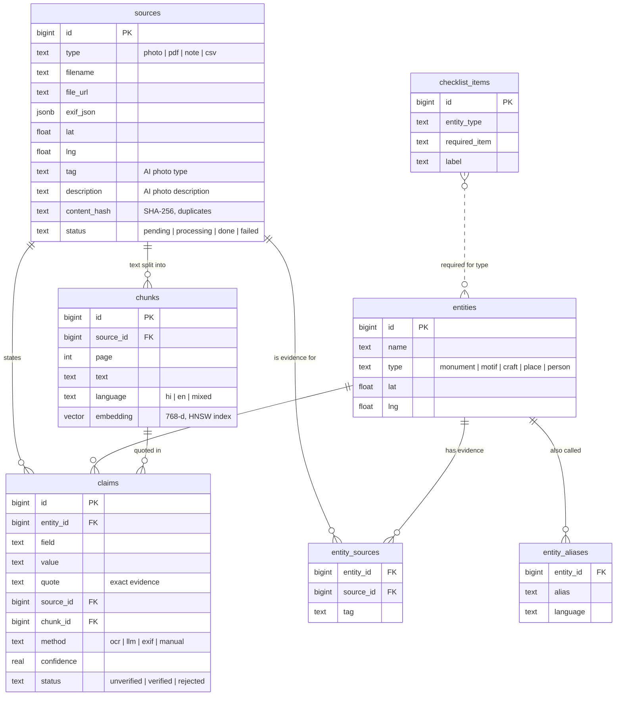

# KathaGraph

**An evidence-aware heritage archive.** KathaGraph turns the messy files that fieldwork produces (photos, scanned Hindi and English documents, field notes) into a searchable, mapped knowledge base. Every fact links back to the exact words it came from. When sources disagree, both versions are shown side by side. For every monument, it lists the documentation that is still missing.

> *"What do we actually know about this structure, why do we believe it, and what do we still need to verify?"*

Built for **HackCult '26, Track 2: Cultural & Digital Heritage**.

| | |
|---|---|
| Live app | https://kathagraph.vercel.app |
| Live API + interactive docs | https://kathagraph-api.onrender.com/docs |
| Team | Manaswi Mahurkar (backend & pipeline) · Sameehan Divekar (frontend, data & demo) |

---

## The problem

Fellowship programmes such as IIT Gandhinagar's Explorer Fellowship collect thousands of photos, regional-language documents and field notes. They end up in an "archival graveyard" of slide decks and cloud folders. Search is only the visible symptom. Underneath, there are five deeper failures:

1. **Context collapse.** A photo survives, but what it shows and where it belongs are lost.
2. **Fragmented memory.** Different teams document the same monument under different names and spellings.
3. **Hidden disagreement.** Two reports give different dates, and nothing tells the reader.
4. **Invisible gaps.** 800 photos can still have no interior shot and no inscription transcript.
5. **Digitisation that erases uncertainty.** OCR errors and AI guesses look like facts once typed up.

## What KathaGraph does

| Capability | How |
|---|---|
| **Read anything** | Photos, PDFs (text and scanned), notes, CSVs. OCR in **Hindi + English** (Tesseract). GPS and capture time from photo EXIF. |
| **Search by meaning, across languages** | Gemini embeddings + pgvector. "who built the stepwell" finds a note saying "completed by Queen Rudabai", and a Hindi query finds English text. Falls back to keyword search if the AI service is down. |
| **Extract facts with their evidence** | Gemini proposes claims (built date, builder, dynasty, location, style, material…) as structured JSON. Each claim stores the **exact quote**, method and confidence, and starts as **unverified**. |
| **Connect the evidence** | Different spellings and scripts ("Adalaj Stepwell", "Adalaj ni Vav", "अडालज की वाव") merge into one monument. Photos link by filename or GPS distance. |
| **Show disagreement** | Same monument + same field + clearly different values = a conflict, shown side by side with both sources. |
| **Expose what's missing** | Each monument is checked against a documentation checklist (exterior and interior photos, inscription, date, builder, location). |
| **Keep humans in charge** | Researchers verify or reject claims. Rejecting one side of a conflict resolves it. |
| **Catch duplicates** | Identical files (by SHA-256) are recognised and not processed twice. |

**Key design rule:** *the AI suggests, it never decides what is true.* Conflicts are detected with plain, testable code, not by asking a model which source is right.

---

## Architecture



**Request flow for an upload:** the API validates each file (type, size, emptiness, duplicate hash), stores it in Supabase Storage, creates a `sources` row and replies **202 Accepted** at once. A background task then runs the pipeline and moves the file through `pending → processing → done | failed`. One bad file can never take the server down, and a warning such as "OCR skipped" is recorded without failing the file.

### Backend modules (`backend/app/`)

| Module | Responsibility |
|---|---|
| `main.py` | App setup, upload, sources, search, admin endpoints, startup recovery |
| `entities.py` | Monuments, claims (verify/reject), reprocessing |
| `pipeline.py` | The six processing stages for one file |
| `text_extract.py` | Notes, PDFs, OCR, chunking, language detection |
| `exif.py` | GPS and capture time from photos |
| `embeddings.py` | Gemini embeddings for semantic search |
| `gemini.py` | Gemini client: JSON-schema answers, retries with back-off, **automatic fallback to lighter models** when one is overloaded |
| `claims.py` | Fact-extraction and photo-description prompts and schemas |
| `matching.py` | Name normalisation (synonyms like vav/stepwell/baoli), fuzzy and GPS matching |
| `analysis.py` | Conflict and gap detection |
| `storage.py` | Supabase Storage uploads |

---

## Database schema



**Why claims are separate from sources:** a claim is *one fact as stated by one source*, never "the truth". Keeping them separate is what makes provenance, conflicts and verification possible. The full schema is in [`backend/schema.sql`](backend/schema.sql), and row-level security is enabled so Supabase's public API cannot read the tables. Only the backend can.

---

## API

Full interactive documentation: **[/docs](https://kathagraph-api.onrender.com/docs)**. Response shapes are in [`CONTRACT.md`](CONTRACT.md).

| Method | Endpoint | Purpose |
|---|---|---|
| GET | `/health` | API + database + pgvector check |
| POST | `/upload` | Upload up to 50 files (20 MB each) → `202` |
| GET | `/sources`, `/sources/{id}` | Files and their processing status |
| GET | `/sources/{id}/text` | What was read from a file |
| DELETE | `/sources/{id}` | Remove a file and everything derived from it |
| POST | `/sources/{id}/reprocess` | Run the pipeline again |
| GET | `/search?q=` | Semantic search (keyword fallback) |
| GET | `/entities` | Monuments with counts of sources, claims, conflicts, gaps |
| GET | `/entities/{id}` | Facts + evidence, conflicts, gaps, sources |
| POST / PATCH | `/entities`, `/entities/{id}` | Register a monument or set its location |
| PATCH | `/claims/{id}` | Verify or reject a claim |

---

## Scalability

The prototype runs on free tiers. The design scales without a rewrite:

- **Processing is already asynchronous** (upload returns 202, then a background task runs). For large archives, swap FastAPI background tasks for a job queue (Redis + RQ/Celery, or Supabase Queues) with several workers. The pipeline functions don't change.
- **Files live in object storage, not on the server**, so API instances are stateless and can be scaled horizontally.
- **Vector search uses an HNSW index** (pgvector), which stays fast into millions of chunks.
- **The heavy AI work is behind an API**, with retries, back-off and model fallback, so it doesn't consume server memory. A self-hosted OCR/embedding service can replace it module by module.
- **Connection pooling** (Supabase pooler, `psycopg_pool`) is the next step for high request volume.

## Limitations (honest)

- Demo data is a small, clearly labelled set about 2–3 Gujarat stepwells.
- Tesseract OCR struggles with worn or handwritten inscriptions. A vision-transformer OCR (e.g. TrOCR) is the upgrade path.
- Claims come from an LLM. They are marked unverified and always carry their quote, but extraction can miss facts.
- No login or access levels yet: everything uploaded is public.
- Gemini's free tier is rate-limited, so large batches are slow (they retry rather than fail).

## Roadmap

1. Access levels (public / researcher / community-only), so sensitive knowledge isn't exposed.
2. Translation of OCR'd text, and Gujarati OCR.
3. Oral-history audio with transcripts.
4. A "next field visit" research brief per monument, generated from its gaps.
5. 3D reconstruction from crowdsourced photos.

---

## Run it locally

**Requirements:** Python 3.10+, Node 20+, a Supabase project, a Gemini API key (free at [aistudio.google.com](https://aistudio.google.com)).

### 1. Database (Supabase)
1. Create a project, open **SQL Editor**, and run [`backend/schema.sql`](backend/schema.sql).
2. **Storage → New bucket** → name `archive`, **public**.

### 2. Backend
```bash
cd backend
python -m venv .venv
.venv\Scripts\activate            # macOS/Linux: source .venv/bin/activate
pip install -r requirements.txt
cp .env.example .env              # Windows: copy .env.example .env
uvicorn app.main:app --reload
```
Fill in `.env`:

| Variable | Where to find it |
|---|---|
| `DATABASE_URL` | Supabase → Connect → Direct → **Session pooler** URI |
| `CORS_ORIGINS` | Comma-separated frontend URLs, e.g. `http://localhost:3000` |
| `SUPABASE_URL` | `https://<project-ref>.supabase.co` |
| `SUPABASE_SERVICE_KEY` | Supabase → Project Settings → API Keys → `service_role` (**secret**) |
| `SUPABASE_BUCKET` | `archive` |
| `GEMINI_API_KEY` | aistudio.google.com → Get API key |

Open http://localhost:8000/health → `{"ok":true,"db":true,"pgvector":true}`.
OCR needs Tesseract with Hindi data (`tesseract-ocr-hin`). It's included in the Docker image. Without it, OCR is skipped with a clear message.

### 3. Frontend
```bash
cd frontend
npm install
echo NEXT_PUBLIC_API_URL=http://localhost:8000 > .env.local
npm run dev
```
Open http://localhost:3000.

### 4. Tests
```bash
cd backend
pip install -r requirements-dev.txt
python -m pytest
```
26 unit tests cover name matching, conflict and gap detection, text extraction and GPS reading.

## Deploy
- **Backend:** Render → New Web Service → this repo, root `backend`, runtime **Docker**. Add the environment variables above (with `CORS_ORIGINS` including the Vercel URL).
- **Frontend:** Vercel → import repo, root `frontend`, set `NEXT_PUBLIC_API_URL` to the Render URL.
- Every push to `main` redeploys both.

## Repo layout
```
backend/     FastAPI app (app/), tests/, schema.sql, Dockerfile
frontend/    Next.js + Tailwind app (map, monument, search, upload pages)
CONTRACT.md  API contract between frontend and backend
```

*Demo data: photos from Wikimedia Commons (CC-licensed, credited in the app). The field notes are written by the team and labelled "demo data".*
