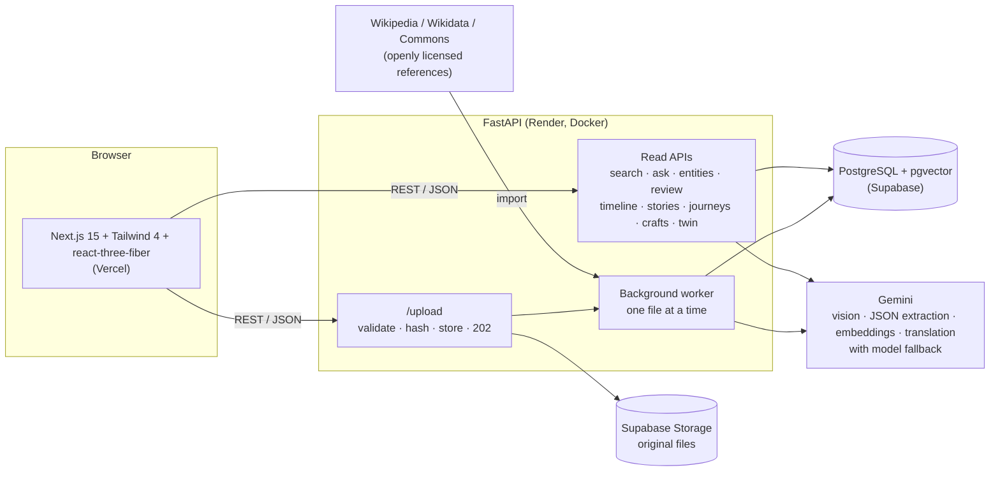
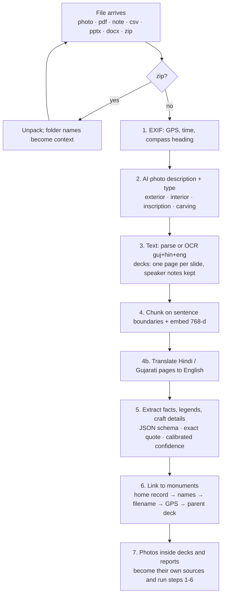
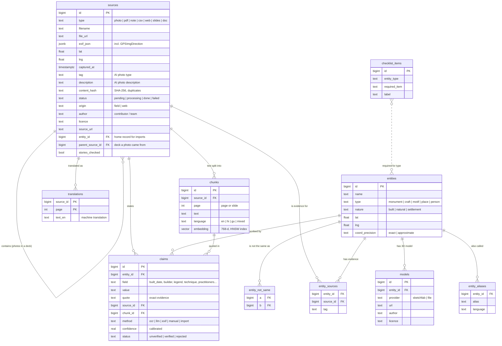

# KathaGraph

[](https://github.com/manaswimahurkar/kathagraph/actions/workflows/ci.yml)

**An evidence-aware, living heritage archive for Gujarat.** KathaGraph takes what fieldwork actually produces (photos, slide decks, Word reports, scanned Hindi and Gujarati documents, field notes, whole zipped folders) and turns it into a searchable, mapped, multilingual knowledge base. Every fact links back to the exact words it came from. When sources disagree, both versions are shown. Regional-language documents are translated page by page. Legends, crafts and travel routes are plotted on the map. And each monument's photos are tracked as the raw material for a 3D digital twin.

> *"What do we actually know about this place, why do we believe it, and what do we still need to record?"*

Built for **HackCult '26 · Track 2: Culture & Digital Heritage · HC26-CULT01** (Blithchron '27, IIT Gandhinagar).

| | |
|---|---|
| Live site | https://kathagraph.vercel.app |
| Live API + interactive docs | https://kathagraph-api.onrender.com/docs |
| Team | Manaswi Mahurkar (backend, AI pipeline) · Sameehan Divekar (frontend, 3D, data) |

---

## The problem

Programmes like IIT Gandhinagar's Explorer Fellowship produce a constant flow of photos, regional-language documents and travel journals. Most of it ends in an "archival graveyard" of slide decks and cloud folders. Search is only the visible symptom. Underneath there are five failures, and KathaGraph is designed around them:

| Failure | What KathaGraph does about it |
|---|---|
| **Context collapse**: a photo survives, but what it shows and where it belongs are lost | Photos are described by AI, matched to their monument by name, filename, GPS or the deck they came from, and placed around the monument |
| **Fragmented memory**: teams record the same place under different names and scripts | Names, spellings and scripts merge into one record; uncertain pairs go to a "Same place?" review |
| **Hidden disagreement**: two reports give different dates and nobody notices | Conflicts are detected by plain, tested code (date ranges, Vikram Samvat, regnal numbers) and shown side by side |
| **Invisible gaps**: 800 photos, but no interior shot and no inscription | Every record is scored against a checklist that fits the kind of site (a temple needs a builder and a date; a city needs its founding; a mountain needs neither); the gaps drive field-visit plans and 3D coverage |
| **Digitisation that erases uncertainty**: OCR errors and AI guesses look like facts | Every AI fact keeps its quote, method and calibrated confidence, starts **unverified**, and enters a risk-ranked review queue |

**Design rule:** *the AI suggests; it never decides what is true.*

## Why Gujarat

KathaGraph starts with one state on purpose, and the site explains why at [/why-gujarat](https://kathagraph.vercel.app/why-gujarat).

> **Why it matters to us.** We chose Gujarat as a nod to IIT Gandhinagar, the institute that set this challenge and gave us the opportunity to build KathaGraph. It is their state, their Explorer Fellows’ field and their question, so if this archive is useful anywhere first, it should be useful there. Working on it, we learned about stepwells, scripts and crafts we had only read about. That is what we want KathaGraph to do for everyone who opens it. (Manaswi Mahurkar and Sameehan Divekar)

- **Where the question was asked.** The challenge comes from IIT Gandhinagar, whose Explorer Fellows travel across India and come home to Gujarat. Their archive should first make sense of the heritage on their doorstep, where records can be checked and revisited in person.
- **Five thousand years in one state.** Harappan Dholavira and Lothal, Solanki stepwells, the sultanate mosques of Ahmedabad and Champaner, Somnath and Palitana: an unbroken record of how people built, prayed and found water. Four sites are UNESCO World Heritage Sites (Champaner-Pavagadh 2004, Rani ki Vav 2014, Historic City of Ahmedabad 2017, Dholavira 2021).
- **Two scripts, one archive.** Records come in Gujarati, Hindi and English, often on the same plaque: the honest test for an archive that must read, translate and search across languages.
- **Living heritage.** Patola, Bandhani, Ajrak, Rogan and Kutch embroidery are heritage too, and as much at risk of being lost in a folder.
- **Deep before wide.** One state done deeply (every fact quoted, every disagreement visible, every gap turned into the next field visit) proves the idea better than thousands of thin pins.

**Gujarat is the pilot, not the limit.** Nothing in the pipeline (upload, OCR, translation, fact extraction, conflicts, gaps, search, Ask, review) knows it is in Gujarat. Growing to India changes the 3D map's outline and terrain, the place list used to pin crafts and stories, and the reference articles imported per region. Rajasthan's stepwells and Maharashtra's caves are the natural next regions.

## The three innovation pathways

The problem statement lists three pathways. KathaGraph combines all three on one shared evidence store.

### 1. Archival NLP / OCR: read and translate regional documents
- OCR in **Gujarati, Hindi and English** (Tesseract `guj+hin+eng`), for scanned PDFs and photos that show writing.
- **Whole-document translation** of Hindi and Gujarati files into English, page by page, stored beside the original. The reader at `/source/{id}` shows the original and the English side by side, labelled as a machine translation.
- **Inscription reader** (`/inscription`): a vision model transcribes and translates an inscription photo; Vikram Samvat and Shaka dates are converted to the Common Era by fixed rules in code, not by the model.
- **Cross-language semantic search** (Gemini embeddings + pgvector) and **cited question answering** (`/ask`) in English, Hindi or Gujarati, where every sentence of the answer cites a passage.

### 2. Geospatial / immersive web: explore the region spatially
- **3D map of Gujarat** (Three.js) with every monument, coloured by how well documented it is, with **time travel**: drag through the centuries and monuments rise as their dates pass. Natural sites (Girnar, Bet Dwarka) stay put; ancient cities (Lothal, Dholavira) appear when they were founded.
- **Stories & legends** (`/stories`): folklore found in the archive's texts, pinned to the place it is told about, with the original quote.
- **Routes & journeys** (`/journeys`): field teams' real routes rebuilt from photo GPS and time stamps, plus heritage trails (stepwells, temples, forts…) in a sensible visiting order.
- **Crafts** (`/crafts`): indigenous crafts as records of their own (technique, practitioners, materials, where they are practised), mapped from the places documents name.
- **Timeline** (`/timeline`) of every dated monument, with uncertain dates kept as ranges; **"I'm here"** (`/field`) for on-site use; **Street View walkthroughs** on each record.

### 3. Computer vision / 3D: towards digital twins from crowdsourced photos
- Each monument page has a **digital-twin panel**: a WebGL scene that hangs every photo where it was taken from (EXIF GPS and compass heading), a coverage ring showing which of the eight sides are photographed, a readiness score and plain instructions ("No photos yet from the north-west side").
- One click downloads a **photogrammetry bundle**: every photo plus `cameras.csv` (position, heading, credit) ready for Meshroom or COLMAP.
- Finished models (uploaded `.glb` or Sketchfab) display in an interactive **3D viewer** at the top of the record.

## Feature tour

| Page | What it does |
|---|---|
| **Map** (`/`) | 3D map of Gujarat; pins coloured by documentation health; time-travel slider; separate markers for built sites, natural sites and settlements |
| **Monument record** (`/monument/{id}`) | Facts with their exact quotes and sources, disagreements side by side, an evidence graph, what's still missing (a checklist that fits the kind of site), a 3D model, Street View, and the 3D digital-twin panel |
| **Search** (`/search`) | Meaning-based search across English, Hindi and Gujarati, with **voice search** |
| **Ask** (`/ask`) | Questions answered only from the archive, every sentence cited, in English, Hindi or Gujarati |
| **Timeline** (`/timeline`) | Every dated site in order, uncertain dates as ranges, disputed dates flagged |
| **Field visits** (`/next`) and **I'm here** (`/field`) | What each site still needs, ranked, and the nearest sites and their gaps when you're on location |
| **Inscriptions** (`/inscription`) | Read and translate an inscription photo; Vikram Samvat and Shaka dates converted by fixed rules |
| **Review** (`/review`) and **Same place?** (`/duplicates`) | Check AI facts against their passages, riskiest first; decide whether two records are one place |
| **Stories**, **Routes**, **Crafts** (`/stories`, `/journeys`, `/crafts`) | Living heritage on the map |
| **Join** and **My contributions** (`/join`, `/me`) | Optional contributor accounts: name, email, password and "What brought you here?"; every file you add and fact you check is credited to you and listed on your profile |
| **Admin** (`/admin`) | Locked by the admin token: archive health, one-click maintenance jobs, failed files (read again or delete), Wikipedia imports, fixing one record, and the contributor list |
| **Why Gujarat** (`/why-gujarat`) | Why the archive starts with one state, and how it grows to India |
| **Upload** (`/upload`) and the file reader (`/source/{id}`) | Add photos, PDFs, notes, decks, Word reports or a zipped folder with credit; read any file in full with its English translation |

---

## Architecture



### The ingestion pipeline (one file)



Uploads return **202 Accepted** immediately; files move through `pending → processing → done | failed`. One bad file never stops the others, and soft problems ("OCR skipped") are stored as warnings on the file. On restart, files left mid-processing are picked up again.

### Backend modules (`backend/app/`)

| Module | Responsibility |
|---|---|
| `main.py` | App setup, upload (incl. zip expansion and contributor credit), sources, readable text, search, admin jobs |
| `pipeline.py` | The processing stages for one file, under a lock sized for a 512 MB server |
| `text_extract.py` / `office.py` | Notes, PDFs, OCR, CSV; PowerPoint and Word parsing with embedded photos; chunking and language detection (en/hi/gu) |
| `exif.py` | GPS, capture time and compass heading |
| `gemini.py` | Gemini client: JSON-schema answers, retries with back-off, fallback to lighter models |
| `claims.py` | Prompts and schemas for facts, legends, crafts and photo descriptions; confidence calibration against the quote |
| `translate.py` | Page-by-page translation of regional-language documents |
| `matching.py` | Name normalisation across spellings and scripts (vav / stepwell / वाव), fuzzy and GPS matching |
| `analysis.py` | Conflict and gap detection: date ranges (BCE, Vikram Samvat, centuries), regnal names, value grouping |
| `entities.py` | Records, claims (verify / reject), priorities, 3D models, Wikipedia and Wikidata imports |
| `ask.py` | Retrieval-augmented answers with per-sentence citations and answer-language rules |
| `insights.py` | Risk-ranked review queue, timeline, inscription reader |
| `merge.py` | "Same place?" duplicate detection and merging |
| `living.py` | Stories, journeys and trails, crafts, digital-twin readiness and photogrammetry bundles |
| `places.py` | Gazetteer of Gujarat towns and districts for placing names found in text |
| `models3d.py` / `wiki.py` / `wikidata.py` / `storage.py` | Categories and 3D models; reference imports; Supabase Storage |

---

## Database schema



**Why claims are separate from sources:** a claim is *one fact as stated by one source*, never "the truth". That separation is what makes provenance, conflicts, verification and the review queue possible. Legends and craft details are claims too, so they get the same quotes, confidence and review. Translations live in their own table so the original text is never overwritten. The full schema is [`backend/schema.sql`](backend/schema.sql); migrations are in [`backend/migrations/`](backend/migrations). Row-level security is on for every table, so only the backend can read them.

---

## API

Interactive documentation: **[/docs](https://kathagraph-api.onrender.com/docs)**. Response shapes: [`CONTRACT.md`](CONTRACT.md).

| Method | Endpoint | Purpose |
|---|---|---|
| GET | `/health` | API + database + pgvector check |
| POST | `/upload` | Up to 50 files (photos/notes 20 MB, decks/reports 50 MB, zip 100 MB) with optional contributor credit → `202` |
| GET | `/sources`, `/sources/{id}` | Files and their processing status |
| GET | `/sources/{id}/text` | The file's text page by page, with English translations and linked records |
| DELETE | `/sources/{id}` | Remove a file and everything derived from it |
| GET | `/search?q=` | Semantic search across languages (keyword fallback) |
| POST | `/ask` | Cited answer from the archive only, in the question's language |
| GET | `/entities`, `/entities/{id}` | Records with facts, evidence, conflicts, gaps, sources, completeness |
| PATCH | `/claims/{id}` | Verify or reject a fact |
| GET | `/review` | Unverified facts ranked by how likely they are to be wrong |
| GET | `/timeline` | Dated monuments with date ranges ("built" or, for settlements, "founded"); natural sites listed apart |
| POST | `/inscription/read` | Transcribe and translate an inscription photo |
| GET | `/duplicates` · POST `/entities/{id}/merge` · POST `/duplicates/dismiss` | "Same place?" review |
| GET | `/priorities` | What to document next, by record |
| GET | `/stories` | Legends with their quotes and map positions |
| GET | `/journeys` | Field journeys from photo GPS/time, and heritage trails |
| GET | `/crafts` | Craft records with facts and documented places |
| GET | `/entities/{id}/twin` | 3D readiness: photo positions, side coverage, score, next shots |
| GET | `/entities/{id}/photo-bundle` | Zip of photos + `cameras.csv` for photogrammetry |
| POST | `/entities/{id}/models` | Attach a Sketchfab model or upload a `.glb` |
| POST | `/import/wikipedia` · `/import/wikidata` | Import openly licensed references for monuments or crafts |
| POST | `/entities/{id}/redate` | Read a monument's texts again for its date of construction or founding only |
| POST | `/admin/classify-nature` | Mark each site built, natural or settlement from Wikidata "instance of" |
| POST | `/admin/translate` · `/admin/extract-stories` · `/admin/rechunk` · `/admin/reindex` | Backfill jobs for files already in the archive |

---

## Scalability

The prototype runs on free tiers (Render 512 MB, Supabase free, Gemini free). The design scales without a rewrite:

- **Asynchronous by design.** Upload returns 202 and work happens in a background task, one file at a time to fit a small server. For a large archive, the lock becomes a job queue (Redis + RQ/Celery or Supabase Queues) with several workers; the pipeline functions don't change.
- **Stateless API.** Files live in object storage and state in Postgres, so API instances scale horizontally behind a load balancer.
- **Vector search on an HNSW index** (pgvector) stays fast into millions of chunks; the same database handles relational queries, so there is no second store to keep in sync.
- **Idempotent, resumable processing.** Duplicate files are caught by SHA-256; translation and story passes skip what is already done, so backfills can be stopped and restarted.
- **AI behind an interface.** Gemini calls go through one client with retries, back-off and model fallback. OCR, translation or embeddings can each be swapped for a self-hosted model (e.g. a vision-transformer OCR such as TrOCR, IndicTrans2 for translation) module by module.
- **Bounded work per request.** Uploads, zip expansion, embedded images, translated pages and photogrammetry bundles all have explicit limits; bundles are streamed through a temporary file, not held in memory.
- **Shared database connections.** A connection pool (`psycopg_pool`, `DB_POOL_MAX` per instance) lends out a few long-lived connections instead of opening one per request, so a burst of visitors waits a moment rather than exhausting Supabase's connection limit. Dead connections are detected and replaced; `/health` reports the pool's state.
- **Protected and rate-limited.** Maintenance jobs (re-processing, imports, backfills, deleting files) need an admin token and are switched off when none is configured. The AI endpoints (`/ask`, `/inscription/read`, `/upload`) are rate-limited per client, so one visitor can't use up the AI quota for everyone.
- **Tested on every push.** GitHub Actions runs the backend tests (with Tesseract installed) and type-checks and builds the frontend.
- **Next steps for heavy traffic:** move the in-process worker to a real job queue with separate workers, move rate-limit counters to Redis when there are several instances, serve image thumbnails from a CDN, and cache the read-mostly endpoints (map, timeline, stories).

## Limitations (honest)

- The archive is a pilot: about 75 Gujarat records from Wikipedia, Wikidata, Commons and the team's own field material.
- Tesseract struggles with worn or handwritten inscriptions; the vision-model inscription reader helps, but transcriptions still need a person to check them.
- Facts, legends and translations come from an LLM. They are labelled, carry their quote, and start unverified, but extraction can miss things and translation can be wrong.
- KathaGraph does not run photogrammetry itself: a free server cannot. It measures coverage, plans shots and packages the photos; the model is built in Meshroom/COLMAP and uploaded back.
- Most imported photos have no GPS, so they can't be placed around a monument; field photos taken with location on can.
- Craft and story locations found in text use a town-level gazetteer, so they are marked approximate.
- Accounts are optional and emails are not verified yet (the site sends no email). Anyone can upload and review; everything uploaded is public. Maintenance jobs are behind an admin token, run from the `/admin` page.
- Gemini's free tier is rate-limited; large batches are slow (they retry rather than fail).

## Roadmap

1. Access levels (public / researcher / community-only) so sensitive community knowledge isn't exposed.
2. Server-side photogrammetry workers (COLMAP on GPU) that turn a "ready" photo set into a model automatically.
3. Oral-history audio with transcripts and translations.
4. Self-hosted Indic OCR and translation models for scale and privacy.
5. Open data export (IIIF manifests, CSV/JSON-LD) for academic reuse.

---

## Run it locally

**Requirements:** Python 3.10+, Node 20+, a Supabase project, a Gemini API key (free at [aistudio.google.com](https://aistudio.google.com)).

### 1. Database (Supabase)
1. Create a project, open **SQL Editor**, and run [`backend/schema.sql`](backend/schema.sql) (it includes every migration).
2. **Storage → New bucket** → name `archive`, **public**.

### 2. Backend
```bash
cd backend
python -m venv .venv
.venv\Scripts\activate            # macOS/Linux: source .venv/bin/activate
pip install -r requirements.txt
cp .env.example .env              # Windows: copy .env.example .env
uvicorn app.main:app --reload
```
Fill in `.env`:

| Variable | Where to find it |
|---|---|
| `DATABASE_URL` | Supabase → Connect → **Session pooler** URI |
| `CORS_ORIGINS` | Comma-separated frontend URLs, e.g. `http://localhost:3000` |
| `SUPABASE_URL` | `https://<project-ref>.supabase.co` |
| `SUPABASE_SERVICE_KEY` | Supabase → Project Settings → API Keys → `service_role` (**secret**) |
| `SUPABASE_BUCKET` | `archive` |
| `GEMINI_API_KEY` | aistudio.google.com → Get API key |
| `ADMIN_TOKEN` | Any long random string; send it as the `X-Admin-Token` header to run admin jobs and imports |

Open http://localhost:8000/health → `{"ok":true,"db":true,"pgvector":true}`.
OCR needs Tesseract with Gujarati and Hindi data (`tesseract-ocr-guj`, `tesseract-ocr-hin`); both are in the Docker image. Without them OCR is skipped with a clear message.

### 3. Frontend
```bash
cd frontend
npm install
echo NEXT_PUBLIC_API_URL=http://localhost:8000 > .env.local
npm run dev
```
Open http://localhost:3000. With `NEXT_PUBLIC_API_URL=mock` the site runs on clearly labelled demo data with no backend.

### 4. Seed it (optional)
With the backend running, import reference articles and let the backfills run:
```bash
curl -X POST localhost:8000/import/wikipedia -H "X-Admin-Token: $ADMIN_TOKEN" -H "Content-Type: application/json" -d "{\"titles\":[\"Adalaj Stepwell\",\"Rani ki vav\"]}"
curl -X POST localhost:8000/import/wikipedia -H "X-Admin-Token: $ADMIN_TOKEN" -H "Content-Type: application/json" -d "{\"titles\":[\"Patola\",\"Ajrakh\",\"Rogan art\"],\"kind\":\"craft\"}"
curl -X POST localhost:8000/admin/extract-stories -H "X-Admin-Token: $ADMIN_TOKEN"
curl -X POST localhost:8000/admin/translate -H "X-Admin-Token: $ADMIN_TOKEN"
```

### 5. Tests
```bash
cd backend
pip install -r requirements-dev.txt
python -m pytest
```
About 110 unit tests (160+ cases) cover name matching across scripts, conflict and date logic (BCE, Vikram Samvat, regnal names), text and slide-deck extraction, EXIF, the review-risk score, duplicate detection, citations, translation triggers, place finding, journeys and digital-twin coverage.

## Deploy
- **Backend:** Render → New Web Service → this repo, root `backend`, runtime **Docker**, with the variables above (`CORS_ORIGINS` including the Vercel URL).
- **Frontend:** Vercel → import repo, root `frontend`, `NEXT_PUBLIC_API_URL` = the Render URL.
- Every push to `main` redeploys both. Run new files in `backend/migrations/` in the Supabase SQL Editor first.

## Repo layout
```
backend/     FastAPI app (app/), tests/, schema.sql, migrations/, Dockerfile
frontend/    Next.js app: app/ (pages), components/ (map, 3D, graph), lib/ (API client, types)
CONTRACT.md  API contract between frontend and backend
```

## Where the data comes from, and credits

- **Text:** English and Hindi Wikipedia articles (CC BY-SA 4.0, "Wikipedia contributors"), imported with their URL and stored as published references, never as field records.
- **Structured facts:** Wikidata statements (CC0): inception, architect or patron, style, material, heritage status, coordinates, and "instance of" for built / natural / settlement.
- **Photos:** Wikimedia Commons, each stored with its author, licence and file page, and shown with that credit on the record.
- **AI extraction:** Gemini reads the texts and proposes facts, legends, craft details and dates. Every one keeps the exact quote it came from, is labelled as AI-extracted and starts unverified until a person checks it on the Review page. Translations are labelled as machine translations.
- **3D models** are embedded through Sketchfab's player and stay the property of their authors: Doron Altaratz (Adalaj, Rani ki Vav details, Jami Masjid, Sarkhej Roza, Dada Harir), CyArk (Rani ki Vav), moniln (Rudra Mahalaya, Sidi Bashir, Mahabat Maqbara), Anirban Basak (Champaner masjid) and Gandhi Ashram Sabarmati (charkha). Each is credited and linked on its record.
- **Fonts:** Samarkan by Titivillus (logo and page titles; free for personal use, used here in a non-commercial student project); Yatra One, EB Garamond, Hind and Hind Vadodara (SIL Open Font License).
- **Map outline:** Gujarat district boundaries from [udit-001/india-maps-data](https://github.com/udit-001/india-maps-data) (Census 2011). **Street View** and satellite views: Google Maps.
- **Field material** uploaded through the site is credited to the contributor and cohort entered on the upload page. See [`demo-data/README.md`](demo-data/README.md) for the files the team uploaded for the demo.

